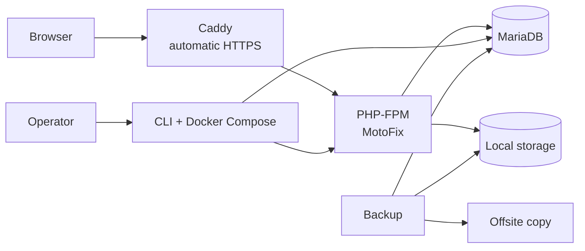

# MotoFix

MotoFix is an open-source, self-hosted garage management system for independent
garages and multi-branch operations. It is designed to run on a garage's own server,
keep data under the garage's control, and remain simple enough for a team
without dedicated IT staff.

> Status: Documentation approved for implementation. Implementation has not started.
> See [`docs/`](docs/00-index.md). The application code is not production-ready yet.

## Why MotoFix

Many garages run on paper, spreadsheets, and disconnected point-of-sale tools.
That makes service history, stock, invoices, and multi-branch reporting unreliable.
Garages need a system that runs on their own server and keeps customer, inventory,
and financial data under their control.

MotoFix aims to provide:

- one system for customers, vehicles, work orders, inventory, sales, and receipts;
- correct server-side pricing, tax, stock, and invoice handling;
- branch-scoped access with consolidated owner reporting;
- a clean, fast cashier workflow with barcode scanning and thermal receipt printing;
- simple installation, backup, restore, diagnostics, and upgrades;
- an open-source codebase that a small team can maintain and audit.

## Product boundaries

- One organization per installation.
- Multiple branches per organization.
- Self-hosted, single central server per organization.
- No offline mode or branch synchronization.
- No telemetry.

See [Project Charter](docs/01-project-charter.md) for the full scope.

## Planned capabilities

### Pilot

- Organization and branch management.
- Users, roles, and branch assignments.
- Customers and vehicles with service history.
- Item and service catalogue.
- Inventory per branch with immutable stock movements.
- Work orders and mechanic assignment.
- Responsive mobile web mechanic flow on Android Chrome.
- Transactions, payments, invoices, and receipts.
- Browser printing for 58 mm and 80 mm thermal paper.
- HID barcode scanner support.
- Non-sequential public identifiers for external URLs.
- CSV import/export and XLSX export.
- Dashboard and basic reports.
- Audit log.
- English and Indonesian UI.
- Installer, Caddy HTTPS, backup, restore, doctor, and upgrade tooling.

### v1.0.0

- Raw ESC/POS, cash drawer, and network printer support.
- Camera barcode scanning, mechanic photo upload, and label printing.
- Native XLSX import with mapping.
- Stock transfers with approval.
- Branch price and availability overrides.
- Partial payments, deposits, and refunds.
- Percentage discounts, stock opname, and scheduled reports.
- Appointments.
- Advanced reports and PDF export.
- Audit UI and export.
- Offsite backup integration.
- Real garage feedback and production hardening.

## Technology

| Area               | Choice                                                   |
| ------------------ | -------------------------------------------------------- |
| Language           | PHP 8.4                                                  |
| Architecture       | Custom MVC with service and repository layers            |
| Routing            | FastRoute                                                |
| Views              | Twig with autoescaping                                   |
| Database           | MariaDB 11.4                                             |
| Migrations         | Phinx                                                    |
| CLI                | Symfony Console                                          |
| Identifiers        | BIGINT UNSIGNED internal + ULID public IDs (symfony/uid) |
| Logging            | Monolog                                                  |
| Testing            | PHPUnit                                                  |
| Static analysis    | PHPStan                                                  |
| Code style         | PHP-CS-Fixer                                             |
| Web server and TLS | Caddy                                                    |
| Runtime packaging  | Docker Compose                                           |

## Architecture overview



The application is organized into HTTP/middleware, controllers, services,
repositories, and views. Business rules live in services, SQL lives in
repositories, and templates only present data.

See [Architecture](docs/03-architecture.md) and the
[ADR index](docs/00-index.md#architecture-decision-records).

## Documentation

Start with the [documentation index](docs/00-index.md).

| Document                                                    | Topic                                      |
| ----------------------------------------------------------- | ------------------------------------------ |
| [Project Charter](docs/01-project-charter.md)               | Problem, vision, scope                     |
| [PRD](docs/02-prd.md)                                       | Requirements and acceptance criteria       |
| [Architecture](docs/03-architecture.md)                     | System design                              |
| [Data Model](docs/04-data-model.md)                         | ERD, tables, constraints                   |
| [Security](docs/05-security.md)                             | Threat model and controls                  |
| [UI and UX](docs/06-ui-ux.md)                               | Flows, screens, i18n                       |
| [Design System](DESIGN.md)                                  | Visual language, components, page patterns |
| [Multi-Branch](docs/07-multi-branch.md)                     | Branch model and authorization             |
| [Self-Hosted Operations](docs/08-self-hosted-operations.md) | Install, backup, upgrade                   |
| [Finance](docs/09-finance.md)                               | Money, tax, payments, invoices             |
| [Hardware](docs/10-hardware-integration.md)                 | Printing and barcode scanning              |
| [Testing](docs/11-testing-qa.md)                            | Test strategy and UAT                      |
| [Contributing](docs/12-contributing.md)                     | Workflow and standards                     |
| [Roadmap](docs/13-roadmap.md)                               | Phases and exit criteria                   |
| [Backlog](docs/14-backlog.md)                               | Epics, stories, priorities                 |

## Requirements

### Server

- Supported Linux LTS release.
- Docker Engine and Docker Compose plugin.
- 2 vCPU and 4 GB RAM recommended.
- 40 GB SSD recommended.
- Domain name with DNS control.
- Ports 80 and 443 reachable.

### Client

- Current Chrome, Edge, or Firefox.
- Printer driver installed for thermal printing.
- USB or Bluetooth barcode scanner in HID keyboard mode for scanning.

## Installation

Installation tooling is part of the implementation phase. The intended path is:

```text
./install.sh
```

The installer will validate the environment, create secrets, start the containers,
run migrations, create the owner, and print the application URL.

Detailed operating procedures are in
[Self-Hosted Operations](docs/08-self-hosted-operations.md).

## Development

Development commands will be added when the foundation is implemented. The
project targets PHP 8.4, MariaDB, and Docker. Frontend dependencies are vendored
locally; the application does not use a CDN and does not require a Node.js build
at runtime.

Contributor expectations are documented in
[Contributing](docs/12-contributing.md). AI coding agents must also follow
[AGENTS.md](AGENTS.md).

## Testing

The test strategy covers unit, integration, feature, security, hardware, and
operational tests. See [Testing and QA](docs/11-testing-qa.md).

The pilot is validated with demo data because a design-partner garage is not yet
available. Real garage feedback is part of v1.0.0.

## Security

- Report vulnerabilities privately according to [SECURITY.md](SECURITY.md).
- Do not open a public issue for a security defect.
- No secrets belong in the repository.
- Security-sensitive changes require focused review.

## Screenshots

Screenshots will be added after the pilot interface is implemented. This project
does not use mock screenshots as evidence of working software.

## License

MIT. See [LICENSE](LICENSE).

## Contributing

Read [CONTRIBUTING.md](CONTRIBUTING.md) and
[docs/12-contributing.md](docs/12-contributing.md). By participating, you agree to
the [Code of Conduct](CODE_OF_CONDUCT.md).
