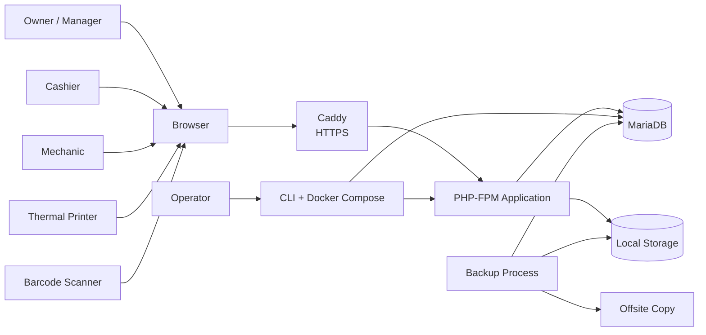
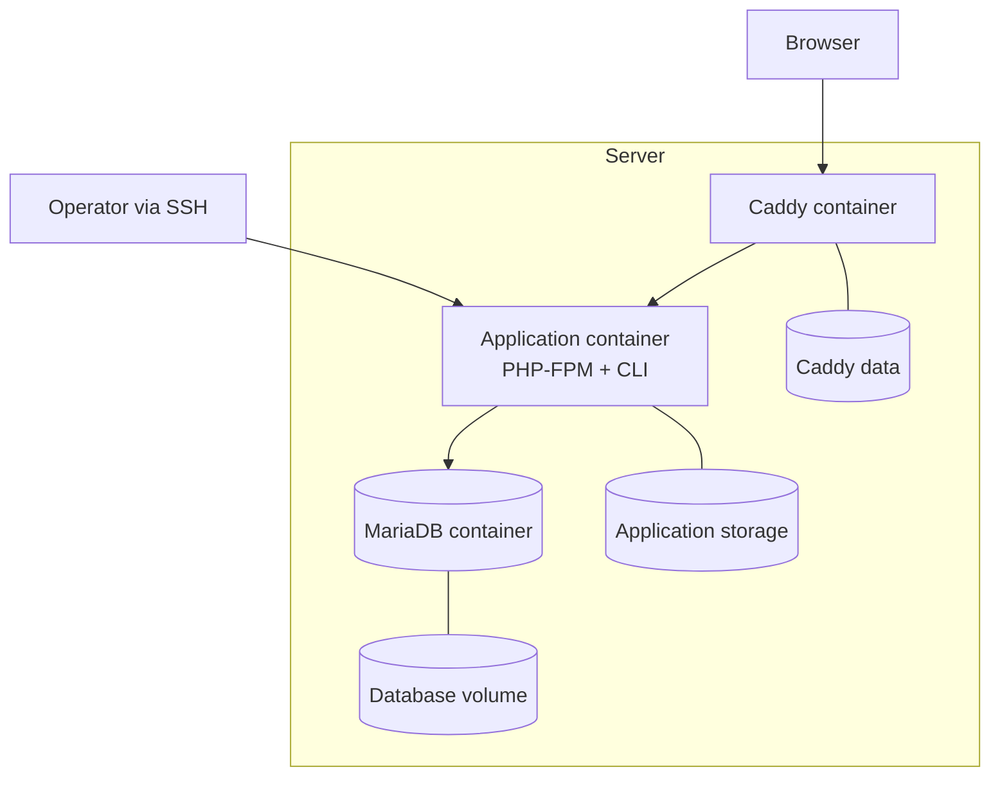
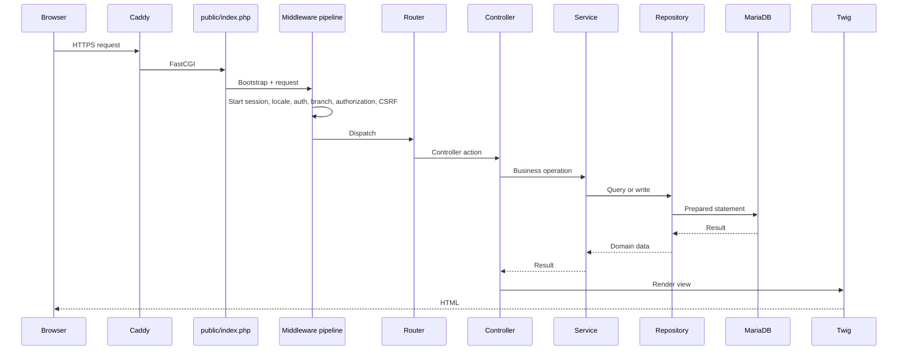

# Architecture

> Status: Approved for implementation
> Audience: Engineering and technical reviewers

## 1. Architectural goals

The architecture must support:

- one organization per installation;
- multiple branches with strict branch-scoped authorization;
- correct financial and inventory transactions;
- simple self-hosted operation;
- an open-source codebase that a small team can maintain;
- automated testing and static analysis;
- clear separation between HTTP, business rules, persistence, and presentation.

The system is self-hosted. A single installation serves one organization, and all
operational records are scoped by branch.

## 2. System context



External dependencies at runtime:

- MariaDB;
- local filesystem for logs and stored files;
- Caddy for TLS termination.

There is no telemetry service, external queue, CDN, or mandatory cloud service.

## 3. Container view



Containers:

| Container | Responsibility                                 |
| --------- | ---------------------------------------------- |
| `caddy`   | TLS, HTTP routing, static files, FastCGI proxy |
| `app`     | PHP-FPM, application code, CLI commands        |
| `db`      | MariaDB database                               |

The application and database are not exposed publicly. Only Caddy publishes ports
80 and 443.

## 4. Request lifecycle



The application is server-rendered in the pilot. Internal JSON responses, such as
health checks, return JSON instead of a view. There is no public API; internal
JSON endpoints exist only where operations require them.
Errors are handled by a central exception handler.

## 5. Layers and responsibilities

| Layer             | Responsibility                                                                | Must not                                 |
| ----------------- | ----------------------------------------------------------------------------- | ---------------------------------------- |
| HTTP / Middleware | Session, locale, authentication, branch context, CSRF, authorization, headers | Contain business rules                   |
| Controller        | Validate request shape, call services, choose response                        | Query the database directly              |
| Service           | Business rules, transactions, orchestration, audit                            | Render HTML                              |
| Repository        | SQL and row mapping, branch scoping                                           | Make authorization decisions             |
| Model / DTO       | Typed data carriers and domain enums                                          | Contain persistence logic                |
| View              | Presentation and translation                                                  | Query the database or decide permissions |

Controllers are intentionally thin. A controller action should read as a short
sequence of validation, service call, and response.

## 6. Proposed directory structure

```text
app/
├── Config/
│   ├── app.php
│   ├── database.php
│   └── logging.php
├── Core/
│   ├── Console/
│   ├── Database/
│   ├── Http/
│   │   ├── Middleware/
│   │   ├── Request.php
│   │   ├── Response.php
│   │   └── Router.php
│   ├── Security/
│   ├── Validation/
│   ├── View/
│   └── Support/
├── Controllers/
├── Services/
├── Repositories/
├── Models/
├── Policies/
├── Middleware/
└── Support/
bin/
├── console
bootstrap/
├── app.php
config/
database/
├── migrations/
└── seeds/
public/
├── index.php
└── assets/
resources/
├── lang/
│   ├── en/
│   └── id/
└── views/
routes/
├── web.php
└── console.php
storage/
├── app/
├── backups/
├── cache/
└── logs/
tests/
├── Unit/
├── Integration/
├── Feature/
└── Support/
docs/
```

The exact placement of some support classes may change during implementation.
Layering rules are mandatory even if directory names change.

## 7. HTTP and routing

- `nikic/fast-route` handles route matching.
- Routes are defined in `routes/web.php`.
- Every route has an explicit HTTP method and a name.
- Route parameters are validated before reaching the controller.
- Unsupported methods return 405, not 404.
- External URLs for customers, vehicles, work orders, and transactions use the
  ULID `public_id`, never the internal integer ID.
- `public_id` route parameters are validated as ULIDs before lookup.
- A central URL generator prevents hardcoded paths in views.
- The application uses a front controller at `public/index.php`.
- The web root is always `public/`; application code is never web-accessible.
- Caddy serves static files and proxies PHP requests to PHP-FPM.

### Middleware order

1. `SecurityHeaders`
2. `StartSession`
3. `SetLocale`
4. `MaintenanceMode`
5. `Authenticate`
6. `ResolveBranch`
7. `Authorize`
8. `VerifyCsrfToken` for unsafe methods
9. Route handler

Middleware is explicit and testable. Authorization is not performed during route
registration.

## 8. Request and response objects

The application uses small framework-owned `Request` and `Response` objects. They
provide:

- method, path, query, body, files, headers, and client IP;
- trusted input accessors;
- redirect and JSON responses;
- status codes and headers.

The request object does not trust proxy headers unless the proxy is configured as
trusted.

## 9. View and internationalization

- Twig is the template engine.
- Autoescaping is enabled by default for HTML contexts.
- A `trans` filter and function expose translations.
- A `money` filter formats integer rupiah according to locale.
- A `datetime` filter converts UTC storage values to the display timezone.
- A `csrf_field` function renders the CSRF hidden input.
- A `can` function checks permissions for UI affordances. It is never the only
  authorization check.
- A `branch` function exposes the active branch to the layout.
- Status values are stored as English keys and translated in the UI.
- UI text must not be hardcoded in templates.

Locale precedence:

1. Explicit user preference.
2. Organization default locale.
3. English fallback.

### Frontend assets

- Bootstrap, the icon set, and Chart.js are pinned and vendored under
  `public/assets/vendor`.
- The application does not load assets from a CDN.
- Custom CSS and JavaScript are plain files under `public/assets`.
- No Node.js build step is required at runtime or for a normal installation.
- Vendored licenses are recorded in the repository.
- Asset updates are reviewed as dependency changes.

### Responsive and mobile views

- The application uses responsive Twig views; there is no separate mobile app or
  mobile API in the pilot.
- Mechanic screens are optimized for Android Chrome and a 360 px viewport.
- Mechanic mobile uses bottom navigation for My jobs, Search, and Profile.
- Work order lists become cards on phones; tables are reserved for wider screens.
- Mechanic mobile does not display prices, payments, checkout, or other financial
  data.
- Camera scanning and photo upload are not part of the pilot mobile flow.
- The same authentication, session, branch context, and authorization middleware
  apply to mobile and desktop.

## 10. Database and persistence

- PDO with prepared statements.
- One shared connection per request or CLI command.
- `utf8mb4` charset.
- Strict SQL mode.
- UTC session timezone.
- Domain repositories are the only place that writes SQL.
- A repository receives a `BranchContext` or an explicit global scope.
- Operational records are branch-scoped.
- Customers, vehicles, work orders, and transactions have an immutable ULID
  `public_id` generated with `symfony/uid`.
- Internal integer IDs remain private and are not exposed in URLs or APIs.
- Money is stored as `BIGINT` in rupiah.
- Quantities are integers in the pilot.
- Timestamps are `DATETIME` in UTC.
- Soft deletion or archival is used for master data with history.
- Financial and stock records are never physically deleted.

### Transactions

The following operations run in a database transaction:

- checkout;
- void;
- stock adjustment;
- stock transfer;
- invoice sequence allocation;
- import batch commit;
- user role changes that must be atomic.

Services own the transaction boundary. Repositories do not call `beginTransaction`
unless the operation is inherently repository-level and documented.

### Concurrency

- Stock updates use conditional writes such as
  `UPDATE inventory_stocks SET quantity = quantity - :qty WHERE branch_id = :branch AND item_id = :item AND quantity >= :qty`.
- If the affected row count is zero, checkout aborts.
- Invoice sequence rows are locked with `SELECT ... FOR UPDATE` inside the transaction.
- Unique constraints are the final defense against duplicate invoices and duplicate business keys.

## 11. Domain services

| Service                | Responsibility                                                       |
| ---------------------- | -------------------------------------------------------------------- |
| `AuthService`          | Credentials, password policy, session regeneration, login throttling |
| `IdentifierService`    | ULID public ID generation and validation                             |
| `BranchContext`        | Active branch, accessible branches, branch selection                 |
| `AuthorizationService` | Roles, permissions, branch and object checks                         |
| `CustomerService`      | Customer and vehicle lifecycle                                       |
| `CatalogueService`     | Items, services, categories, price resolution                        |
| `InventoryService`     | Stock queries, movements, adjustments, transfers                     |
| `WorkOrderService`     | Work order lifecycle and assignment                                  |
| `CheckoutService`      | Server-side totals, stock consumption, transaction creation          |
| `PaymentService`       | Payment posting and change calculation                               |
| `InvoiceNumberService` | Atomic per-branch sequence allocation                                |
| `ReceiptService`       | Receipt data and print view                                          |
| `ReportService`        | Aggregations and exports                                             |
| `ImportService`        | CSV parsing, validation, import runs                                 |
| `ExportService`        | CSV and XLSX generation                                              |
| `AuditService`         | Append-only audit records                                            |
| `SettingsService`      | Organization and branch settings                                     |
| `SystemService`        | Health, diagnostics, backup metadata                                 |

Services are constructed explicitly. A small container may be used for wiring, but
service location must not hide dependencies.

## 12. Authentication and authorization

- Authentication is email and password.
- Passwords are hashed with Argon2id when available, otherwise the configured
  memory-hard default.
- Sessions are server-side and regenerated after sign-in.
- Logout is a POST request with CSRF protection.
- Login attempts are rate limited by account and IP.
- Authorization uses permissions plus branch scope.
- Owners and admins have global branch scope.
- Branch roles require branch assignment.
- Customers and vehicles are globally readable by owner, admin, manager, and
  cashier. A mechanic can read only customers and vehicles linked to assigned work
  orders.
- A cashier may create a customer or vehicle. Edit is limited to records created
  in an assigned branch or linked to a work order or transaction in an assigned
  branch.
- Object-level checks verify that a transaction, work order, or stock record
  belongs to the active branch and that the user may access that branch.
- Public IDs are identifiers, not authorization. Every lookup still checks
  permission and branch scope.
- Denied access returns 403 for known resources and 404 where revealing existence
  is unsafe.

See [05 Security](05-security.md) and
[ADR-0003](decisions/ADR-0003-branch-authorization.md).

## 13. Configuration

Configuration is environment-driven and validated at boot.

Required values include:

- `APP_ENV`, `APP_DEBUG`, `APP_URL`, `APP_TIMEZONE`;
- database host, port, name, user, and password;
- session cookie settings;
- log level and log path;
- backup path and retention;
- mail settings, optional;
- trusted proxy settings, optional.

Rules:

- `.env` is never committed.
- `.env.example` documents every required key.
- Production refuses to start with debug mode enabled.
- Secrets are generated by the installer.
- Configuration is accessed through typed config objects, not `$_ENV` directly.

## 14. Logging and error handling

- Monolog provides structured logs.
- Every request has a request ID.
- Log context includes request ID, user ID, branch ID, route, and duration where available.
- Passwords, tokens, and full customer identifiers are redacted.
- Application logs and audit logs are separate.
- Production errors show a generic page with a correlation ID.
- Development errors may show details.
- The exception handler maps domain errors to appropriate HTTP status codes.
- No database error message or stack trace is sent to the browser.

## 15. CLI and operations

Symfony Console provides commands:

| Command               | Purpose                                                       |
| --------------------- | ------------------------------------------------------------- |
| `install`             | Interactive installation and owner creation                   |
| `migrate`             | Run migrations                                                |
| `migrate:rollback`    | Roll back the last migration batch                            |
| `seed`                | Seed reference and demo data                                  |
| `create-owner`        | Create or repair the owner account                            |
| `backup`              | Create a database and storage backup                          |
| `restore`             | Restore from a backup with confirmation                       |
| `doctor`              | Check runtime, database, permissions, disk, and configuration |
| `support:bundle`      | Create a redacted diagnostics archive                         |
| `maintenance`         | Enable or disable maintenance mode                            |
| `user:reset-password` | Reset a password from the CLI                                 |

Commands are idempotent where possible and print actionable output.

## 16. Caddy and deployment

- Caddy terminates TLS and serves static files.
- Caddy proxies PHP requests to `app:9000`.
- Automatic HTTPS uses the configured domain.
- Local development uses HTTP on localhost.
- Caddy stores certificates in a persistent volume.
- Application and database ports are not published.
- The production compose file references versioned images.
- The application container runs as a non-root user.
- Health checks exist for application and database.
- See [08 Self-Hosted Operations](08-self-hosted-operations.md) and
  [ADR-0007](decisions/ADR-0007-caddy.md).

## 17. Hardware integration

Pilot:

- Receipts use browser print with dedicated 58 mm and 80 mm CSS.
- Barcode scanners use HID keyboard input.
- No raw USB or network printer access from the server.

Later:

- Raw ESC/POS through a documented local or network path.
- Cash drawer control.
- Camera-based scanning.
- Barcode label printing.

See [10 Hardware Integration](10-hardware-integration.md) and
[ADR-0008](decisions/ADR-0008-hardware-integration.md).

## 18. Performance and scalability

- Paginate all lists.
- Index foreign keys, status columns, dates, and search columns.
- Avoid N+1 queries in reports and lists.
- Use database aggregation for dashboards.
- Keep the request path free of external network calls.
- Cache only safe, derived data; do not cache authorization decisions across requests.
- The reference deployment is a small VPS. The application must remain usable
  with 20 concurrent users and a database of 100,000 transactions.
- Heavy imports run with bounded memory and clear progress reporting.

## 19. Testing seams

The architecture must allow:

- service tests without HTTP;
- repository integration tests against MariaDB;
- feature tests through the HTTP kernel;
- authorization tests for every branch-scoped route;
- checkout and stock concurrency tests;
- import tests with fixture files;
- public ID route binding and internal ID exposure tests;
- mobile mechanic viewport tests on Android Chrome;
- backup and restore smoke tests in CI or a scheduled environment.

See [11 Testing and QA](11-testing-qa.md).

## 20. Future extensions

The following are intentionally outside the pilot but should not require a
rewrite:

- stock transfers with approval;
- branch price and availability overrides;
- suppliers and purchase orders (post-v1.0.0 candidate; requires an approved ADR
  and PRD update first);
- appointments;
- partial payments and refunds;
- offsite backup integration;
- raw ESC/POS printing;
- camera barcode scanning;
- mechanic photo upload;
- audit log UI and export;
- PDF reports;
- SMS or WhatsApp notifications.

The current design keeps `BranchContext`, services, and repositories explicit so
that branch-scoped behavior remains consistent as modules are added.

## 21. Decision records

- [ADR-0001: Architecture](decisions/ADR-0001-architecture.md)
- [ADR-0002: Single organization, multi-branch](decisions/ADR-0002-single-organization-multi-branch.md)
- [ADR-0003: Branch authorization](decisions/ADR-0003-branch-authorization.md)
- [ADR-0004: Money and tax](decisions/ADR-0004-money-tax.md)
- [ADR-0005: Self-hosted distribution](decisions/ADR-0005-self-hosted-distribution.md)
- [ADR-0006: Backup and restore](decisions/ADR-0006-backup-restore.md)
- [ADR-0007: Caddy](decisions/ADR-0007-caddy.md)
- [ADR-0008: Hardware integration](decisions/ADR-0008-hardware-integration.md)
- [ADR-0009: Identifier strategy](decisions/ADR-0009-identifier-strategy.md)
