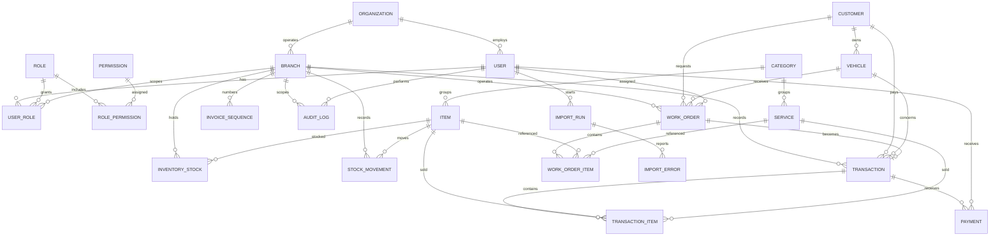

# Data Model

> Status: Approved for implementation
> Audience: Engineering and QA

## 1. Principles

- One organization per installation.
- Operational records belong to exactly one branch through `branch_id`.
- Customers and vehicles are shared across branches within the organization.
- Catalogue items and services are global to the organization in the pilot.
- Stock is per branch.
- Money is stored as integer rupiah (`BIGINT`), never floating point.
- Timestamps are stored in UTC and displayed in the organization or branch timezone.
- Stock movements, payments, transaction items, and audit records are immutable.
- Master data with history is archived or soft-deleted, not physically removed.
- Unique constraints are the final protection against duplicate business keys.
- Database constraints are used where they are portable and reliable; application
  validation remains mandatory.

## 2. Entity relationship diagram

## 3. Naming and type conventions

| Concern       | Convention                                                                                                                                     |
| ------------- | ---------------------------------------------------------------------------------------------------------------------------------------------- |
| Table names   | `snake_case`, plural                                                                                                                           |
| Primary keys  | `id`, `BIGINT UNSIGNED`, auto-increment unless singleton or a small bounded lookup (see [ADR-0009](decisions/ADR-0009-identifier-strategy.md)) |
| Foreign keys  | `<entity>_id`, same type as target                                                                                                             |
| External ID   | `public_id`, `CHAR(26)`, ULID, unique and immutable                                                                                            |
| Money         | `BIGINT` in rupiah                                                                                                                             |
| Tax rates     | `INT` basis points (`1100` = 11.00%)                                                                                                           |
| Quantities    | `INT` in the pilot                                                                                                                             |
| Dates         | `DATETIME` in UTC                                                                                                                              |
| Booleans      | `TINYINT(1)` with `is_` or `has_` prefix                                                                                                       |
| Status values | `VARCHAR` with stable English keys                                                                                                             |
| Soft delete   | `deleted_at DATETIME NULL`                                                                                                                     |
| Archival      | `is_active TINYINT(1)` where history must remain                                                                                               |
| JSON          | `JSON` for audit snapshots and import errors                                                                                                   |
| Character set | `utf8mb4`                                                                                                                                      |
| Collation     | `utf8mb4_unicode_ci` or the database default for the supported MariaDB version                                                                 |

Application validation must never rely solely on database types. Check constraints
are added where MariaDB supports them reliably.

### 3.1 Identifier strategy

- Internal primary keys and foreign keys default to `BIGINT UNSIGNED`
  auto-increment. `roles` and `permissions` use `SMALLINT UNSIGNED` because they
  are small bounded lookup tables, and the singleton `organization` row uses
  `TINYINT UNSIGNED`; see [ADR-0009](decisions/ADR-0009-identifier-strategy.md).
- Customers, vehicles, work orders, and transactions expose an immutable ULID
  `public_id`.
- `public_id` is generated by the application using `symfony/uid`.
- `public_id` stores a 26-character uppercase Crockford Base32 ULID.
- `public_id` columns use an ASCII binary collation for exact matching.
- `public_id` is used in external URLs and APIs. Internal integer IDs are never
  exposed in URLs or APIs.
- Invoice numbers remain human-readable and separate from `public_id`.
- A `public_id` is never reused, including after archival or void.
- `public_id` is not an authorization control. Branch and permission checks remain
  mandatory for every request.
- ULID values are time-ordered and contain a timestamp; they are not secrets.

See [ADR-0009](decisions/ADR-0009-identifier-strategy.md).

## 4. Organization

Exactly one row exists per installation. The installer creates it.

### `organization`

| Column           | Type               | Constraints                      | Notes                    |
| ---------------- | ------------------ | -------------------------------- | ------------------------ |
| `id`             | `TINYINT UNSIGNED` | PK, fixed value `1`              | Singleton                |
| `name`           | `VARCHAR(120)`     | NOT NULL                         | Display name             |
| `legal_name`     | `VARCHAR(160)`     | NULL                             | Legal entity name        |
| `tax_id`         | `VARCHAR(32)`      | NULL                             | NPWP or equivalent       |
| `address`        | `TEXT`             | NULL                             | Display address          |
| `phone`          | `VARCHAR(32)`      | NULL                             | Display phone            |
| `email`          | `VARCHAR(160)`     | NULL                             | Contact email            |
| `logo_path`      | `VARCHAR(255)`     | NULL                             | Relative path in storage |
| `currency`       | `CHAR(3)`          | NOT NULL, default `IDR`          | Pilot supports IDR       |
| `timezone`       | `VARCHAR(64)`      | NOT NULL, default `Asia/Jakarta` | Display timezone         |
| `default_locale` | `VARCHAR(5)`       | NOT NULL, default `id`           | `en` or `id`             |
| `invoice_prefix` | `VARCHAR(16)`      | NOT NULL, default `INV`          | Invoice prefix           |
| `receipt_footer` | `TEXT`             | NULL                             | Printed footer           |
| `tax_rate_bp`    | `INT`              | NOT NULL, default `0`            | Basis points             |
| `tax_mode`       | `VARCHAR(16)`      | NOT NULL, default `exclusive`    | `exclusive` in pilot     |
| `created_at`     | `DATETIME`         | NOT NULL                         | UTC                      |
| `updated_at`     | `DATETIME`         | NOT NULL                         | UTC                      |

The organization table is intentionally minimal; feature flags and optional
settings belong in `settings`.

## 5. Branches

### `branches`

| Column       | Type              | Constraints           | Notes                                |
| ------------ | ----------------- | --------------------- | ------------------------------------ |
| `id`         | `BIGINT UNSIGNED` | PK                    |                                      |
| `code`       | `VARCHAR(16)`     | NOT NULL, UNIQUE      | Used in invoice numbers              |
| `name`       | `VARCHAR(120)`    | NOT NULL              |                                      |
| `address`    | `TEXT`            | NOT NULL              | Receipt header                       |
| `phone`      | `VARCHAR(32)`     | NOT NULL              | Receipt header                       |
| `timezone`   | `VARCHAR(64)`     | NULL                  | Inherits organization when null      |
| `is_active`  | `TINYINT(1)`      | NOT NULL, default `1` | Inactive branches cannot be selected |
| `created_at` | `DATETIME`        | NOT NULL              | UTC                                  |
| `updated_at` | `DATETIME`        | NOT NULL              | UTC                                  |

Rules:

- `code` is uppercase alphanumeric with hyphens or underscores.
- `code` is immutable after the first invoice is created for the branch.
- Deactivation does not delete history.

## 6. Identity and access

### `users`

| Column          | Type              | Constraints           | Notes                         |
| --------------- | ----------------- | --------------------- | ----------------------------- |
| `id`            | `BIGINT UNSIGNED` | PK                    |                               |
| `name`          | `VARCHAR(120)`    | NOT NULL              | Display name                  |
| `email`         | `VARCHAR(160)`    | NOT NULL, UNIQUE      | Login identifier              |
| `username`      | `VARCHAR(60)`     | NOT NULL, UNIQUE      | Display and CLI convenience   |
| `password_hash` | `VARCHAR(255)`    | NOT NULL              | Argon2id or configured hash   |
| `locale`        | `VARCHAR(5)`      | NULL                  | Overrides organization locale |
| `is_active`     | `TINYINT(1)`      | NOT NULL, default `1` | Inactive users cannot sign in |
| `last_login_at` | `DATETIME`        | NULL                  | UTC                           |
| `created_at`    | `DATETIME`        | NOT NULL              | UTC                           |
| `updated_at`    | `DATETIME`        | NOT NULL              | UTC                           |

### `roles`

| Column       | Type                | Constraints      | Notes                                                     |
| ------------ | ------------------- | ---------------- | --------------------------------------------------------- |
| `id`         | `SMALLINT UNSIGNED` | PK               |                                                           |
| `key`        | `VARCHAR(32)`       | NOT NULL, UNIQUE | `owner`, `admin`, `branch_manager`, `cashier`, `mechanic` |
| `name`       | `VARCHAR(60)`       | NOT NULL         | Display name                                              |
| `is_global`  | `TINYINT(1)`        | NOT NULL         | Owner and admin are global                                |
| `created_at` | `DATETIME`          | NOT NULL         | UTC                                                       |
| `updated_at` | `DATETIME`          | NOT NULL         | UTC                                                       |

### `permissions`

| Column        | Type                | Constraints      | Notes          |
| ------------- | ------------------- | ---------------- | -------------- |
| `id`          | `SMALLINT UNSIGNED` | PK               |                |
| `key`         | `VARCHAR(80)`       | NOT NULL, UNIQUE | Dot notation   |
| `description` | `VARCHAR(255)`      | NULL             | Human-readable |
| `created_at`  | `DATETIME`          | NOT NULL         | UTC            |

### `role_permissions`

| Column          | Type                | Constraints             |
| --------------- | ------------------- | ----------------------- |
| `role_id`       | `SMALLINT UNSIGNED` | PK part, FK roles       |
| `permission_id` | `SMALLINT UNSIGNED` | PK part, FK permissions |

### `user_roles`

| Column       | Type                | Constraints        | Notes                 |
| ------------ | ------------------- | ------------------ | --------------------- |
| `id`         | `BIGINT UNSIGNED`   | PK                 |                       |
| `user_id`    | `BIGINT UNSIGNED`   | NOT NULL, FK users |                       |
| `role_id`    | `SMALLINT UNSIGNED` | NOT NULL, FK roles |                       |
| `branch_id`  | `BIGINT UNSIGNED`   | NULL, FK branches  | Null for global roles |
| `created_at` | `DATETIME`          | NOT NULL           | UTC                   |

Constraints:

- `branch_key` is a generated column equal to `IFNULL(branch_id, 0)` and
  `UNIQUE (user_id, role_id, branch_key)` is enforced. A plain
  `(user_id, role_id, branch_id)` unique index cannot prevent duplicate global
  role rows because MariaDB treats `NULL` values as distinct.
- Global roles require `branch_id IS NULL`.
- Branch roles require `branch_id IS NOT NULL`.
- A user must retain at least one owner role in the installation.

### `login_attempts`

| Column       | Type              | Constraints | Notes                |
| ------------ | ----------------- | ----------- | -------------------- |
| `id`         | `BIGINT UNSIGNED` | PK          |                      |
| `email`      | `VARCHAR(160)`    | NOT NULL    | Attempted identifier |
| `ip`         | `VARCHAR(45)`     | NOT NULL    | IPv4 or IPv6         |
| `success`    | `TINYINT(1)`      | NOT NULL    |                      |
| `user_agent` | `VARCHAR(255)`    | NULL        |                      |
| `created_at` | `DATETIME`        | NOT NULL    | UTC                  |

Indexes: `(email, created_at)`, `(ip, created_at)`.

### `password_resets`

| Column       | Type              | Constraints        | Notes            |
| ------------ | ----------------- | ------------------ | ---------------- |
| `id`         | `BIGINT UNSIGNED` | PK                 |                  |
| `user_id`    | `BIGINT UNSIGNED` | NOT NULL, FK users |                  |
| `token_hash` | `CHAR(64)`        | NOT NULL, UNIQUE   | SHA-256 of token |
| `expires_at` | `DATETIME`        | NOT NULL           | UTC              |
| `used_at`    | `DATETIME`        | NULL               | UTC              |
| `created_at` | `DATETIME`        | NOT NULL           | UTC              |

Password reset by email is optional in v1.0.0. The pilot uses owner-driven reset.

## 7. Customers and vehicles

### `customers`

| Column              | Type              | Constraints       | Notes                                                |
| ------------------- | ----------------- | ----------------- | ---------------------------------------------------- |
| `id`                | `BIGINT UNSIGNED` | PK                | Internal only                                        |
| `public_id`         | `CHAR(26)`        | NOT NULL, UNIQUE  | ULID external identifier                             |
| `name`              | `VARCHAR(120)`    | NOT NULL          |                                                      |
| `phone`             | `VARCHAR(32)`     | NOT NULL          | Searchable                                           |
| `email`             | `VARCHAR(160)`    | NULL              |                                                      |
| `address`           | `TEXT`            | NULL              |                                                      |
| `notes`             | `TEXT`            | NULL              |                                                      |
| `created_branch_id` | `BIGINT UNSIGNED` | NULL, FK branches | Source branch for analytics and cashier edit scoping |
| `deleted_at`        | `DATETIME`        | NULL              | Archive                                              |
| `created_at`        | `DATETIME`        | NOT NULL          | UTC                                                  |
| `updated_at`        | `DATETIME`        | NOT NULL          | UTC                                                  |

Indexes: `public_id` (unique), `name`, `phone`, `created_branch_id`, `deleted_at`.

Customers are global to the organization. Branches do not own customers.
`created_branch_id` identifies the branch that created the record and supports
cashier edit scoping.

### `vehicles`

| Column              | Type                | Constraints            | Notes                |
| ------------------- | ------------------- | ---------------------- | -------------------- |
| `id`                | `BIGINT UNSIGNED`   | PK                     | Internal only        |
| `public_id`         | `CHAR(26)`          | NOT NULL, UNIQUE       | ULID external ID     |
| `customer_id`       | `BIGINT UNSIGNED`   | NOT NULL, FK customers |                      |
| `license_plate`     | `VARCHAR(16)`       | NOT NULL, UNIQUE       | Normalized uppercase |
| `created_branch_id` | `BIGINT UNSIGNED`   | NULL, FK branches      | Source branch        |
| `brand`             | `VARCHAR(60)`       | NOT NULL               |                      |
| `model`             | `VARCHAR(80)`       | NOT NULL               |                      |
| `production_year`   | `SMALLINT UNSIGNED` | NULL                   |                      |
| `color`             | `VARCHAR(40)`       | NULL                   |                      |
| `vin`               | `VARCHAR(32)`       | NULL                   |                      |
| `engine_number`     | `VARCHAR(32)`       | NULL                   |                      |
| `odometer`          | `INT UNSIGNED`      | NULL                   | Last known value     |
| `notes`             | `TEXT`              | NULL                   |                      |
| `deleted_at`        | `DATETIME`          | NULL                   | Archive              |
| `created_at`        | `DATETIME`          | NOT NULL               | UTC                  |
| `updated_at`        | `DATETIME`          | NOT NULL               | UTC                  |

Indexes: `public_id` (unique), `customer_id`, `created_branch_id`,
`license_plate`, `deleted_at`.

`created_branch_id` identifies the branch that created the vehicle and supports
cashier edit scoping.

## 8. Catalogue

### `categories`

| Column        | Type              | Constraints           | Notes               |
| ------------- | ----------------- | --------------------- | ------------------- |
| `id`          | `BIGINT UNSIGNED` | PK                    |                     |
| `type`        | `VARCHAR(16)`     | NOT NULL              | `item` or `service` |
| `name`        | `VARCHAR(80)`     | NOT NULL              |                     |
| `description` | `TEXT`            | NULL                  |                     |
| `is_active`   | `TINYINT(1)`      | NOT NULL, default `1` |                     |
| `created_at`  | `DATETIME`        | NOT NULL              | UTC                 |
| `updated_at`  | `DATETIME`        | NOT NULL              | UTC                 |

Constraint: UNIQUE `(type, name)`.

### `items`

| Column            | Type              | Constraints             | Notes                    |
| ----------------- | ----------------- | ----------------------- | ------------------------ |
| `id`              | `BIGINT UNSIGNED` | PK                      |                          |
| `category_id`     | `BIGINT UNSIGNED` | NULL, FK categories     |                          |
| `sku`             | `VARCHAR(64)`     | NOT NULL, UNIQUE        |                          |
| `barcode`         | `VARCHAR(64)`     | NULL, UNIQUE            | Scanner lookup           |
| `name`            | `VARCHAR(160)`    | NOT NULL                |                          |
| `unit`            | `VARCHAR(24)`     | NOT NULL, default `pcs` |                          |
| `buy_price`       | `BIGINT`          | NOT NULL, default `0`   | Rupiah                   |
| `sell_price`      | `BIGINT`          | NOT NULL, default `0`   | Rupiah                   |
| `min_stock_alert` | `INT UNSIGNED`    | NOT NULL, default `0`   | Per organization default |
| `track_stock`     | `TINYINT(1)`      | NOT NULL, default `1`   |                          |
| `is_active`       | `TINYINT(1)`      | NOT NULL, default `1`   |                          |
| `deleted_at`      | `DATETIME`        | NULL                    | Archive                  |
| `created_at`      | `DATETIME`        | NOT NULL                | UTC                      |
| `updated_at`      | `DATETIME`        | NOT NULL                | UTC                      |

Indexes: `category_id`, `name`, `barcode`, `deleted_at`.

### `services`

| Column             | Type              | Constraints           | Notes    |
| ------------------ | ----------------- | --------------------- | -------- |
| `id`               | `BIGINT UNSIGNED` | PK                    |          |
| `category_id`      | `BIGINT UNSIGNED` | NULL, FK categories   |          |
| `code`             | `VARCHAR(64)`     | NULL, UNIQUE          | Optional |
| `name`             | `VARCHAR(160)`    | NOT NULL              |          |
| `description`      | `TEXT`            | NULL                  |          |
| `duration_minutes` | `INT UNSIGNED`    | NULL                  | Estimate |
| `price`            | `BIGINT`          | NOT NULL, default `0` | Rupiah   |
| `is_active`        | `TINYINT(1)`      | NOT NULL, default `1` |          |
| `deleted_at`       | `DATETIME`        | NULL                  | Archive  |
| `created_at`       | `DATETIME`        | NOT NULL              | UTC      |
| `updated_at`       | `DATETIME`        | NOT NULL              | UTC      |

Indexes: `category_id`, `name`, `deleted_at`.

### `item_branch_settings` (v1.0.0)

| Column                     | Type              | Constraints           | Notes                     |
| -------------------------- | ----------------- | --------------------- | ------------------------- |
| `id`                       | `BIGINT UNSIGNED` | PK                    |                           |
| `branch_id`                | `BIGINT UNSIGNED` | NOT NULL, FK branches |                           |
| `item_id`                  | `BIGINT UNSIGNED` | NOT NULL, FK items    |                           |
| `sell_price_override`      | `BIGINT`          | NULL                  | Null means use item price |
| `min_stock_alert_override` | `INT UNSIGNED`    | NULL                  | Null means use item value |
| `is_available`             | `TINYINT(1)`      | NOT NULL, default `1` |                           |
| `created_at`               | `DATETIME`        | NOT NULL              | UTC                       |
| `updated_at`               | `DATETIME`        | NOT NULL              | UTC                       |

Constraint: UNIQUE `(branch_id, item_id)`.

### `service_branch_settings` (v1.0.0)

Same shape as `item_branch_settings`, using `service_id` and
`price_override`.

The tables exist in the schema from the pilot onward so that branch overrides can
be introduced without a breaking migration. The pilot uses defaults and does not
expose override administration.

## 9. Inventory

### `inventory_stocks`

| Column       | Type              | Constraints           | Notes                  |
| ------------ | ----------------- | --------------------- | ---------------------- |
| `id`         | `BIGINT UNSIGNED` | PK                    |                        |
| `branch_id`  | `BIGINT UNSIGNED` | NOT NULL, FK branches |                        |
| `item_id`    | `BIGINT UNSIGNED` | NOT NULL, FK items    |                        |
| `quantity`   | `INT`             | NOT NULL, default `0` | Must stay non-negative |
| `updated_at` | `DATETIME`        | NOT NULL              | UTC                    |

Constraints:

- UNIQUE `(branch_id, item_id)`.
- CHECK `quantity >= 0`.

The row is created on the first stock movement. A missing row is treated as zero.

### `stock_movements`

| Column           | Type              | Constraints           | Notes                                             |
| ---------------- | ----------------- | --------------------- | ------------------------------------------------- |
| `id`             | `BIGINT UNSIGNED` | PK                    |                                                   |
| `branch_id`      | `BIGINT UNSIGNED` | NOT NULL, FK branches |                                                   |
| `item_id`        | `BIGINT UNSIGNED` | NOT NULL, FK items    |                                                   |
| `type`           | `VARCHAR(24)`     | NOT NULL              | See types below                                   |
| `quantity_delta` | `INT`             | NOT NULL              | Positive or negative                              |
| `unit_cost`      | `BIGINT`          | NULL                  | Cost snapshot where relevant                      |
| `reference_type` | `VARCHAR(32)`     | NULL                  | `transaction`, `adjustment`, `import`, `transfer` |
| `reference_id`   | `BIGINT UNSIGNED` | NULL                  | Reference ID                                      |
| `notes`          | `TEXT`            | NULL                  | Reason or context                                 |
| `user_id`        | `BIGINT UNSIGNED` | NULL, FK users        | Actor                                             |
| `created_at`     | `DATETIME`        | NOT NULL              | UTC                                               |

Allowed types:

- `opening`
- `in`
- `adjustment`
- `sale`
- `sale_void`
- `transfer_in` (v1.0.0)
- `transfer_out` (v1.0.0)

Indexes: `(branch_id, item_id, created_at)`, `(reference_type, reference_id)`, `created_at`.

Movements are immutable. Corrections are new movements.

## 10. Work orders

### `work_orders`

| Column                 | Type              | Constraints               | Notes              |
| ---------------------- | ----------------- | ------------------------- | ------------------ |
| `id`                   | `BIGINT UNSIGNED` | PK                        | Internal only      |
| `public_id`            | `CHAR(26)`        | NOT NULL, UNIQUE          | ULID external ID   |
| `branch_id`            | `BIGINT UNSIGNED` | NOT NULL, FK branches     |                    |
| `customer_id`          | `BIGINT UNSIGNED` | NOT NULL, FK customers    |                    |
| `vehicle_id`           | `BIGINT UNSIGNED` | NOT NULL, FK vehicles     |                    |
| `status`               | `VARCHAR(20)`     | NOT NULL, default `draft` | See statuses       |
| `complaint`            | `TEXT`            | NULL                      | Customer complaint |
| `diagnosis`            | `TEXT`            | NULL                      | Mechanic findings  |
| `odometer_in`          | `INT UNSIGNED`    | NULL                      |                    |
| `assigned_mechanic_id` | `BIGINT UNSIGNED` | NULL, FK users            | Primary mechanic   |
| `notes`                | `TEXT`            | NULL                      |                    |
| `created_by`           | `BIGINT UNSIGNED` | NOT NULL, FK users        |                    |
| `completed_at`         | `DATETIME`        | NULL                      | UTC                |
| `cancelled_at`         | `DATETIME`        | NULL                      | UTC                |
| `created_at`           | `DATETIME`        | NOT NULL                  | UTC                |
| `updated_at`           | `DATETIME`        | NOT NULL                  | UTC                |

Statuses:

- `draft`
- `in_progress`
- `waiting_parts`
- `completed`
- `cancelled`

Indexes: `public_id` (unique), `(branch_id, status, created_at)`,
`customer_id`, `vehicle_id`, `assigned_mechanic_id`, `created_at`.

Rules:

- A work order belongs to exactly one branch.
- A work order cannot be converted to a transaction more than once.
- Completed work orders are read-only except for notes and audit.
- Cancellation requires a reason in notes and is audited.

### `work_order_items`

| Column          | Type              | Constraints              | Notes                |
| --------------- | ----------------- | ------------------------ | -------------------- |
| `id`            | `BIGINT UNSIGNED` | PK                       |                      |
| `work_order_id` | `BIGINT UNSIGNED` | NOT NULL, FK work_orders |                      |
| `item_type`     | `VARCHAR(16)`     | NOT NULL                 | `item` or `service`  |
| `item_id`       | `BIGINT UNSIGNED` | NULL, FK items           | Required for item    |
| `service_id`    | `BIGINT UNSIGNED` | NULL, FK services        | Required for service |
| `description`   | `VARCHAR(255)`    | NOT NULL                 | Snapshot             |
| `quantity`      | `INT`             | NOT NULL, default `1`    |                      |
| `unit_price`    | `BIGINT`          | NOT NULL                 | Resolved server-side |
| `mechanic_id`   | `BIGINT UNSIGNED` | NULL, FK users           | Line-level mechanic  |
| `notes`         | `TEXT`            | NULL                     |                      |
| `created_at`    | `DATETIME`        | NOT NULL                 | UTC                  |
| `updated_at`    | `DATETIME`        | NOT NULL                 | UTC                  |

Constraint: exactly one of `item_id` or `service_id` is set, matching `item_type`.

## 11. Sales

### `transactions`

| Column           | Type              | Constraints                  | Notes                              |
| ---------------- | ----------------- | ---------------------------- | ---------------------------------- |
| `id`             | `BIGINT UNSIGNED` | PK                           | Internal only                      |
| `public_id`      | `CHAR(26)`        | NOT NULL, UNIQUE             | ULID external ID                   |
| `branch_id`      | `BIGINT UNSIGNED` | NOT NULL, FK branches        |                                    |
| `work_order_id`  | `BIGINT UNSIGNED` | NULL, UNIQUE, FK work_orders | One transaction per work order     |
| `invoice_number` | `VARCHAR(40)`     | NOT NULL, UNIQUE             | Human-readable                     |
| `customer_id`    | `BIGINT UNSIGNED` | NOT NULL, FK customers       |                                    |
| `vehicle_id`     | `BIGINT UNSIGNED` | NOT NULL, FK vehicles        |                                    |
| `cashier_id`     | `BIGINT UNSIGNED` | NOT NULL, FK users           |                                    |
| `status`         | `VARCHAR(16)`     | NOT NULL, default `unpaid`   | `unpaid`, `paid`, `void`           |
| `subtotal`       | `BIGINT`          | NOT NULL                     | Sum of line totals before discount |
| `discount_total` | `BIGINT`          | NOT NULL, default `0`        | Transaction-level discount         |
| `tax_rate_bp`    | `INT`             | NOT NULL, default `0`        | Snapshot                           |
| `tax_total`      | `BIGINT`          | NOT NULL, default `0`        | Snapshot                           |
| `grand_total`    | `BIGINT`          | NOT NULL                     | Final amount                       |
| `paid_total`     | `BIGINT`          | NOT NULL, default `0`        | Sum of applied payments            |
| `notes`          | `TEXT`            | NULL                         |                                    |
| `void_reason`    | `TEXT`            | NULL                         | Required when voided               |
| `voided_by`      | `BIGINT UNSIGNED` | NULL, FK users               |                                    |
| `voided_at`      | `DATETIME`        | NULL                         | UTC                                |
| `created_at`     | `DATETIME`        | NOT NULL                     | UTC                                |
| `updated_at`     | `DATETIME`        | NOT NULL                     | UTC                                |

Indexes: `public_id` (unique), `(branch_id, created_at)`, `status`,
`customer_id`, `vehicle_id`, `cashier_id`, `invoice_number` (unique).

Rules:

- `subtotal`, `discount_total`, `tax_total`, `grand_total`, and `paid_total`
  are computed by the server.
- `grand_total = subtotal - discount_total + tax_total`.
- `paid_total` must equal `grand_total` for a paid transaction in the pilot.
- Invoice numbers are never reused, including after void.

### `transaction_items`

| Column            | Type              | Constraints               | Notes                                                                  |
| ----------------- | ----------------- | ------------------------- | ---------------------------------------------------------------------- |
| `id`              | `BIGINT UNSIGNED` | PK                        |                                                                        |
| `transaction_id`  | `BIGINT UNSIGNED` | NOT NULL, FK transactions |                                                                        |
| `item_type`       | `VARCHAR(16)`     | NOT NULL                  | `item` or `service`                                                    |
| `item_id`         | `BIGINT UNSIGNED` | NULL, FK items            |                                                                        |
| `service_id`      | `BIGINT UNSIGNED` | NULL, FK services         |                                                                        |
| `description`     | `VARCHAR(255)`    | NOT NULL                  | Snapshot                                                               |
| `quantity`        | `INT`             | NOT NULL                  |                                                                        |
| `unit_price`      | `BIGINT`          | NOT NULL                  | Snapshot                                                               |
| `unit_cost`       | `BIGINT`          | NULL                      | Item cost snapshot                                                     |
| `discount_amount` | `BIGINT`          | NOT NULL, default `0`     | Reserved for a future line-discount feature; always `0` until approved |
| `line_total`      | `BIGINT`          | NOT NULL                  | `quantity * unit_price - discount_amount`                              |
| `mechanic_id`     | `BIGINT UNSIGNED` | NULL, FK users            |                                                                        |
| `created_at`      | `DATETIME`        | NOT NULL                  | UTC                                                                    |

Transaction items are immutable after posting.

### `payments`

| Column            | Type              | Constraints               | Notes                                              |
| ----------------- | ----------------- | ------------------------- | -------------------------------------------------- |
| `id`              | `BIGINT UNSIGNED` | PK                        |                                                    |
| `branch_id`       | `BIGINT UNSIGNED` | NOT NULL, FK branches     |                                                    |
| `transaction_id`  | `BIGINT UNSIGNED` | NOT NULL, FK transactions |                                                    |
| `method`          | `VARCHAR(20)`     | NOT NULL                  | `cash`, `bank_transfer`, `qris`, `debit`, `credit` |
| `amount`          | `BIGINT`          | NOT NULL                  | Amount applied to the transaction                  |
| `tendered_amount` | `BIGINT`          | NULL                      | Cash received                                      |
| `change_amount`   | `BIGINT`          | NULL                      | Cash returned                                      |
| `reference`       | `VARCHAR(120)`    | NULL                      | Transfer/QRIS reference                            |
| `paid_at`         | `DATETIME`        | NOT NULL                  | UTC                                                |
| `received_by`     | `BIGINT UNSIGNED` | NOT NULL, FK users        |                                                    |
| `notes`           | `TEXT`            | NULL                      |                                                    |
| `created_at`      | `DATETIME`        | NOT NULL                  | UTC                                                |

Indexes: `transaction_id`, `(branch_id, paid_at)`, `method`.

Payments are immutable after posting. Refunds and corrections are handled through
void or future refund records.

### `invoice_sequences`

| Column        | Type              | Constraints           | Notes    |
| ------------- | ----------------- | --------------------- | -------- |
| `id`          | `BIGINT UNSIGNED` | PK                    |          |
| `branch_id`   | `BIGINT UNSIGNED` | NOT NULL, FK branches |          |
| `period`      | `CHAR(6)`         | NOT NULL              | `YYYYMM` |
| `last_number` | `INT UNSIGNED`    | NOT NULL, default `0` |          |
| `updated_at`  | `DATETIME`        | NOT NULL              | UTC      |

Constraint: UNIQUE `(branch_id, period)`.

Allocation runs inside the checkout transaction with `SELECT ... FOR UPDATE`.

## 12. Settings and audit

### `settings`

| Column       | Type              | Constraints       | Notes                           |
| ------------ | ----------------- | ----------------- | ------------------------------- |
| `id`         | `BIGINT UNSIGNED` | PK                |                                 |
| `scope`      | `VARCHAR(16)`     | NOT NULL          | `organization` or `branch`      |
| `branch_id`  | `BIGINT UNSIGNED` | NULL, FK branches | Required for branch scope       |
| `key`        | `VARCHAR(80)`     | NOT NULL          | Dot notation                    |
| `value`      | `TEXT`            | NULL              | Serialized by type              |
| `type`       | `VARCHAR(16)`     | NOT NULL          | `string`, `int`, `bool`, `json` |
| `created_at` | `DATETIME`        | NOT NULL          | UTC                             |
| `updated_at` | `DATETIME`        | NOT NULL          | UTC                             |

Application-level uniqueness: `(scope, branch_id, key)`.

### `audit_logs`

| Column        | Type              | Constraints       | Notes                   |
| ------------- | ----------------- | ----------------- | ----------------------- |
| `id`          | `BIGINT UNSIGNED` | PK                |                         |
| `branch_id`   | `BIGINT UNSIGNED` | NULL, FK branches | Null for global actions |
| `user_id`     | `BIGINT UNSIGNED` | NULL, FK users    | Null for system actions |
| `action`      | `VARCHAR(80)`     | NOT NULL          | Stable key              |
| `entity_type` | `VARCHAR(80)`     | NOT NULL          |                         |
| `entity_id`   | `BIGINT UNSIGNED` | NULL              |                         |
| `old_values`  | `JSON`            | NULL              | Redacted snapshot       |
| `new_values`  | `JSON`            | NULL              | Redacted snapshot       |
| `ip`          | `VARCHAR(45)`     | NULL              |                         |
| `user_agent`  | `VARCHAR(255)`    | NULL              |                         |
| `created_at`  | `DATETIME`        | NOT NULL          | UTC                     |

Indexes: `(branch_id, created_at)`, `(user_id, created_at)`,
`(entity_type, entity_id)`, `created_at`.

Audit logs are append-only. The application does not expose update or delete
operations for this table.

## 13. Import tracking

### `import_runs`

| Column              | Type              | Constraints           | Notes                                                         |
| ------------------- | ----------------- | --------------------- | ------------------------------------------------------------- |
| `id`                | `BIGINT UNSIGNED` | PK                    |                                                               |
| `user_id`           | `BIGINT UNSIGNED` | NOT NULL, FK users    |                                                               |
| `branch_id`         | `BIGINT UNSIGNED` | NULL, FK branches     | For opening stock                                             |
| `type`              | `VARCHAR(24)`     | NOT NULL              | `customers`, `vehicles`, `items`, `services`, `opening_stock` |
| `original_filename` | `VARCHAR(255)`    | NOT NULL              |                                                               |
| `status`            | `VARCHAR(16)`     | NOT NULL              | `pending`, `completed`, `failed`                              |
| `rows_total`        | `INT UNSIGNED`    | NOT NULL, default `0` |                                                               |
| `rows_success`      | `INT UNSIGNED`    | NOT NULL, default `0` |                                                               |
| `rows_failed`       | `INT UNSIGNED`    | NOT NULL, default `0` |                                                               |
| `created_at`        | `DATETIME`        | NOT NULL              | UTC                                                           |
| `completed_at`      | `DATETIME`        | NULL                  | UTC                                                           |

### `import_errors`

| Column          | Type              | Constraints              | Notes                 |
| --------------- | ----------------- | ------------------------ | --------------------- |
| `id`            | `BIGINT UNSIGNED` | PK                       |                       |
| `import_run_id` | `BIGINT UNSIGNED` | NOT NULL, FK import_runs |                       |
| `row_number`    | `INT UNSIGNED`    | NOT NULL                 | CSV row               |
| `message`       | `VARCHAR(255)`    | NOT NULL                 | Translated in UI      |
| `raw_data`      | `JSON`            | NULL                     | Redacted row snapshot |
| `created_at`    | `DATETIME`        | NOT NULL                 | UTC                   |

Import errors are retained for troubleshooting and audited through the import run.

## 14. Index strategy

Required indexes:

- foreign keys used in joins and filters;
- `branches.code`;
- `users.email`, `users.username`;
- `customers.public_id`, `customers.name`, `customers.phone`,
  `customers.created_branch_id`;
- `vehicles.public_id`, `vehicles.license_plate`, `vehicles.customer_id`,
  `vehicles.created_branch_id`;
- `items.sku`, `items.barcode`, `items.name`;
- `services.name`, `services.code`;
- `inventory_stocks(branch_id, item_id)`;
- `stock_movements(branch_id, item_id, created_at)`;
- `work_orders.public_id`, `work_orders(branch_id, status, created_at)`;
- `transactions.public_id`, `transactions(branch_id, created_at)`,
  `transactions.invoice_number`;
- `payments(branch_id, paid_at)`;
- `audit_logs(branch_id, created_at)`;
- `login_attempts(email, created_at)`, `login_attempts(ip, created_at)`.

Full-text search is not required in the pilot. Search uses prefix or exact indexes
where practical.

## 15. Migration strategy

- Phinx manages schema changes.
- Migrations are forward-only in production; rollback is for development and
  emergency recovery.
- Every migration must be tested against an empty database and against the
  previous supported release.
- Destructive changes require a backup and an explicit release note.
- Data migrations are separate from schema migrations when they are long-running.
- Seeders create reference data and optional demo data, never production secrets.
- The installer runs migrations and creates the owner account.

## 16. Seed data

Reference seeds:

- roles;
- permissions;
- role-permission mappings;
- default categories only if the organization chooses them.

Demo seeds:

- one organization;
- two branches;
- users for each role;
- sample customers and vehicles;
- sample items and services;
- opening stock;
- sample work orders;
- sample paid and void transactions;
- audit examples.

Demo seeds are clearly marked and must be explicitly requested.

## 17. Future schema extensions

The following are planned for v1.0.0 or later and are not part of the pilot schema
unless noted:

- `stock_transfers`, `stock_transfer_items`;
- `suppliers`, `purchases`, `purchase_items` (post-v1.0.0 candidates; not part of
  the approved PRD scope);
- `appointments`;
- `refunds`;
- `notifications`;
- `printers`;
- `barcode_labels`;
- `document_sequences` for other document types.

These extensions must preserve the branch-scoped model and require a new ADR for
structural changes.

## 18. Data retention

- Transactions, payments, stock movements, and audit logs are retained for the
  life of the installation.
- Master data may be archived but not physically deleted if it is referenced.
- Import runs and errors are retained for a configurable period.
- Logs follow the logging retention policy.
- Backups follow the backup retention policy.

Retention configuration is documented in
[08 Self-Hosted Operations](08-self-hosted-operations.md).
