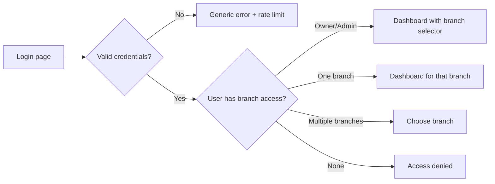
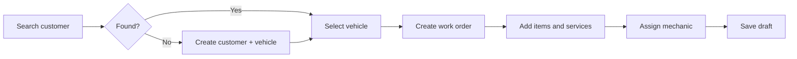
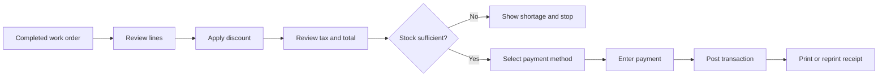
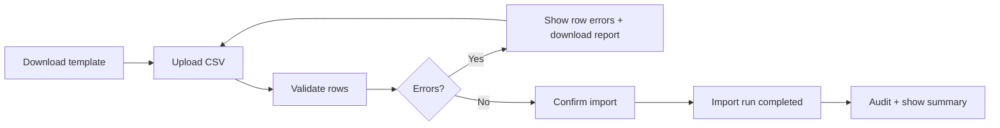
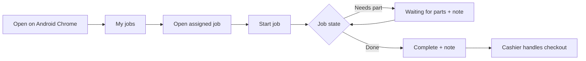

# UI and UX

> Status: Approved for implementation
> Audience: Product, design, engineering

## 1. Experience principles

MotoFix is used at a busy cashier desk and in a workshop. The interface must be
fast, predictable, and tolerant of interruptions.

Principles:

1. **Task first.** Every screen answers one operational question.
2. **Few clicks.** The cashier flow should not require unnecessary navigation.
3. **Keyboard and scanner friendly.** Barcode input and common actions work
   without a mouse.
4. **Clear state.** Users always know the active branch, work order status, and
   transaction state.
5. **No surprises.** Destructive actions are explicit and confirmed.
6. **Readable under pressure.** High contrast, clear labels, meaningful errors.
7. **Translated.** No mixed-language interface.
8. **Low bandwidth.** No CDN dependency and no heavy client framework.

## 2. Sitemap

```text
Login
└── Application
    ├── Dashboard
    ├── Work Orders
    │   ├── List
    │   ├── Create
    │   ├── Detail
    │   └── Checkout
    ├── Transactions
    │   ├── List
    │   ├── Detail
    │   └── Receipt
    ├── Customers
    │   ├── List
    │   ├── Detail
    │   ├── Create / Edit
    │   └── Vehicle profile
    ├── Inventory
    │   ├── Stock list
    │   ├── Item list
    │   ├── Stock movements
    │   ├── Adjustment
    │   └── Import opening stock
    ├── Catalogue
    │   ├── Items
    │   ├── Services
    │   └── Categories
    ├── Reports
    │   ├── Sales
    │   ├── Inventory
    │   └── Work orders
    ├── Administration
    │   ├── Branches
    │   ├── Users
    │   ├── Roles and access
    │   ├── Organization settings
    │   ├── Audit log
    │   └── System
    └── Profile
        ├── Password
        └── Language
```

Navigation is filtered by permission. Inactive or inaccessible branches are not
shown in branch selectors. On phones, mechanics use a reduced navigation with My
jobs, Search, and Profile; other roles use the offcanvas sidebar.

## 3. Global layout

- Top bar: organization name, active branch selector, language switcher, user menu.
- Side navigation: dashboard, work orders, transactions, customers, inventory,
  catalogue, reports, administration.
- Content area: page title, primary action, filters, table or form.
- Feedback area: validation summary, flash messages, and inline errors.
- Footer: application version and environment indicator in non-production.

Mobile behavior:

- On phones below 576 px, mechanics use bottom navigation: My jobs, Search, and
  Profile.
- Other roles use an offcanvas sidebar on phones and tablets.
- The topbar becomes compact; branch and language controls remain reachable.
- Mechanic work order lists become cards instead of horizontal tables.
- Mechanic detail uses a sticky action bar for Start, Waiting for parts, and
  Complete.
- Financial data, checkout, and printing actions are hidden from mechanic mobile
  screens.
- Camera and photo controls are not part of the pilot mobile flow.
- Touch targets are at least 44 px and respect safe-area insets.

On narrow screens, the side navigation collapses. Tables scroll horizontally.
The primary cashier actions remain reachable.

## 4. Key user flows

### 4.1 Sign in



### 4.2 Create a work order



### 4.3 Checkout



### 4.4 Barcode scan

The scanner behaves as a keyboard. A visible scan field is focused when the user
presses the configured shortcut or clicks the scan icon. The scanner sends the
code followed by Enter. The application resolves:

1. exact item barcode;
2. exact item SKU;
3. exact invoice number;
4. exact vehicle plate;
5. exact customer phone;
6. otherwise, a clear not-found message.

### 4.5 Import



### 4.6 Mechanic mobile job update



Mechanic mobile never exposes price, payment, invoice, or checkout controls.

## 5. Screen requirements

### Dashboard

- Branch selector and consolidated view for owner/admin.
- Today's sales, transaction count, average ticket, and low-stock count.
- Recent work orders.
- Sales trend chart with zero-filled days.
- Quick actions: new work order, new customer, scan.

### Work order list

- Filters: status, date, mechanic, customer, vehicle.
- Columns: number, customer, vehicle, status, mechanic, total estimate, updated.
- On mobile, cards show number, customer, vehicle, status, and updated time.
- Status badges use text, not color alone.
- Empty state explains how to create the first work order.

### Work order detail

- Header: customer, vehicle, branch, status, mechanic.
- Actions by status and permission.
- Line editor for items and services.
- Totals preview.
- Notes and audit summary.
- Checkout action when completed.
- Mechanic mobile shows contact details, items, notes, and status actions, but no
  financial data or checkout.
- Mechanic mobile cannot cancel a work order.

### Checkout

- Read-only line review.
- Discount input with validation.
- Tax display from settings.
- Total summary.
- Payment method selection.
- Cash tendered and change calculation.
- Confirmation with irreversible-action warning.
- Success state with receipt actions.

### Transactions

- Filters: date range, branch, status, payment method, cashier.
- Columns: invoice, date, customer, vehicle, total, status, cashier.
- Detail: immutable snapshot, payments, void action with reason, receipt link.

### Customers and vehicles

- Search by name, phone, or plate.
- Owner, admin, manager, and cashier can search all customers in the installation.
- Mechanic search is limited to customers and vehicles linked to assigned work
  orders.
- Customer detail shows vehicles and cross-branch history to authorized users.
- Vehicle detail shows service history to authorized users.
- Cashier edit affordances appear only for records created in an assigned branch
  or linked to a work order or transaction in an assigned branch.
- Duplicate plate error is shown inline.

### Inventory

- Stock per branch with low-stock highlighting.
- Item list with SKU, barcode, price, and active status.
- Movement history with type, quantity, reference, and actor.
- Adjustment form requires a reason.
- Opening stock import uses a template.

### Catalogue

- Items and services separated by tabs.
- Price change warning and audit notice.
- Archive instead of delete when history exists.

### Reports

- Date range defaults to today.
- Branch filter respects authorization.
- Export CSV and XLSX.
- Large reports are paginated or streamed.

### Administration

- Branches: create, edit, activate/deactivate.
- Users: create, roles, branch assignments, activate/deactivate.
- Organization: identity, tax, locale, invoice, receipt.
- Audit: filter by date, user, branch, action.
- System: version, database, disk, last backup, health, support bundle.

## 6. Design system

The visual source of truth is [DESIGN.md](../DESIGN.md). It defines the palette,
typography, layout, components, page patterns, interaction rules, and print
design.

UX constraints that must remain true:

- Bootstrap 5 is the base component library and is bundled locally.
- No CDN is used at runtime.
- Status is always shown with text in addition to color.
- Tables use compact density for cashier screens.
- Forms use clear labels above fields and inline help where needed.
- Buttons use verb labels: "Save work order", "Post payment", "Void transaction".
- Destructive actions use danger styling and a confirmation dialog.
- Empty states include a primary action.
- Loading states use disabled buttons and a spinner, not layout shifts.

## 7. Internationalization

- Supported locales: `en` and `id`.
- Locale files are organized by domain: `common`, `auth`, `customers`,
  `vehicles`, `catalog`, `inventory`, `work_orders`, `transactions`,
  `reports`, `admin`, `validation`, `errors`.
- Translation keys use dot notation, for example `work_orders.status.completed`.
- No user-facing string is hardcoded in templates or controllers.
- Status values stored in the database are stable English keys.
- Dates use locale-aware formatting.
- Numbers and currency use locale-aware grouping. Currency remains IDR.
- The language switcher preserves the current page.
- User preference overrides organization default.
- Missing translations fall back to English and are reported in development.

## 8. Accessibility

Target WCAG 2.1 AA for core flows.

- Every input has a programmatic label.
- Error messages are associated with fields.
- Focus order follows the visual order.
- Focus is visible.
- Modals trap focus and restore it on close.
- Tables have header cells.
- Status is not conveyed by color alone.
- Contrast meets AA.
- Keyboard shortcuts are documented and do not conflict with browser shortcuts.
- Mobile touch targets are at least 44 px.
- Mobile layouts respect safe-area insets and support text zoom.
- The mechanic mobile flow is usable one-handed where practical.
- The receipt page is readable by screen readers before printing.

## 9. Error and feedback patterns

- Validation errors appear at the top and inline.
- Forms preserve input after an error.
- Server errors show a correlation ID and a support hint.
- Permission errors explain that the action is not allowed for the active branch.
- Stock shortage errors show the item and available quantity.
- Duplicate data errors name the conflicting field.
- Success messages are concise and disappear automatically.
- Destructive confirmations state the consequence.

## 10. Printing experience

- Receipt pages use a dedicated layout with no navigation.
- 58 mm and 80 mm widths are selectable.
- Browser print is the only pilot printing path.
- The receipt includes a reprint marker when applicable.
- Print styles hide screen-only controls.
- The cashier can print without leaving the transaction detail.

See [10 Hardware Integration](10-hardware-integration.md).

## 11. Localization of content

- Organization and branch names are user content and are not translated.
- Item and service names are user content and are not translated.
- System labels, statuses, validation, and help text are translated.
- Date, time, and number formats follow the locale.
- Timezone display follows the organization or branch setting.

## 12. UX acceptance criteria

- A cashier can create a work order, add an item by barcode, post payment, and
  print a receipt without using the mouse after the initial sign-in.
- A user cannot see another branch in any selector or list.
- Every screen has a translated title and empty state.
- The interface works at 1280x720 and remains usable on a tablet.
- The mechanic flow works on Android Chrome at 360 px and above.
- Mechanic mobile uses bottom navigation and card lists, not horizontal tables.
- Mechanic mobile never shows financial data or checkout actions.
- The main flows pass a keyboard-only review.
- No screen depends on an external CDN.
- Error messages are actionable and translated.
