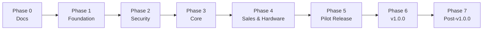

# Roadmap

> Status: Approved for implementation
> Audience: Everyone

## 1. Planning approach

The roadmap is organized by phases and exit criteria. Calendar dates are
intentionally excluded. A phase is complete only when its exit criteria are met.

The pilot is a scope-frozen release. New ideas discovered during the pilot go to
the v1.0.0 backlog unless they block the pilot's acceptance criteria.

## 2. Phase overview

```text
Phase 0: Documentation and decisions
    |
Phase 1: Foundation
    |
Phase 2: Security and integrity
    |
Phase 3: Core operations
    |
Phase 4: Sales, hardware, and reporting
    |
Phase 5: Pilot hardening and release
    |
Phase 6: v1.0.0 enhancements
    |
Phase 7: Post-v1.0.0
```

## 3. Phase 0: Documentation and decisions

### Status

Complete. The approved documentation baseline is the input to Phase 1.

### Goals

- Define the product, architecture, data model, security model, and operations.
- Resolve scope decisions before implementation.
- Establish the open-source project structure.

### Deliverables

- `docs/00` through `docs/14`.
- ADR-0001 through ADR-0009.
- `DESIGN.md` design system.
- `AGENTS.md` repository guidance.
- README, license, security policy, contribution guide, code of conduct,
  changelog, issue and pull request templates.
- Approved pilot and v1.0.0 scope.

### Exit criteria

- Documents are reviewed and accepted.
- No unresolved blocking decision remains.
- Scope-freeze rules are agreed.
- Architecture and data model are consistent with the PRD.

## 4. Phase 1: Foundation

### Goals

- Create a reproducible development and deployment foundation.
- Make the application installable before feature work expands.

### Deliverables

- Application bootstrap and configuration.
- FastRoute routing and middleware pipeline.
- Twig integration with autoescaping and i18n.
- Phinx migrations and seeders.
- ULID `public_id` generation and schema foundations.
- Monolog logging and central error handling.
- Secure session foundation.
- Symfony Console commands and installer skeleton.
- Docker development and production foundations.
- Caddy configuration.
- CI for formatting, static analysis, and tests.
- Test harness with MariaDB.
- Initial README and local setup instructions.

### Exit criteria

- A clean development environment starts from documented commands.
- A clean installation runs migrations and creates an owner.
- Caddy serves the application over HTTP locally and HTTPS in staging.
- CI is green on an empty application.
- Health and doctor commands report expected state.

## 5. Phase 2: Security and integrity

### Goals

- Establish authentication, authorization, and branch isolation.
- Make financial and stock operations safe before building UI features on top.

### Deliverables

- Login, logout, password policy, rate limiting, and session rotation.
- Roles, permissions, and branch assignments.
- Branch context and authorization middleware.
- Object-level authorization checks for branches and customer/vehicle access.
- Public ID route binding for customers, vehicles, work orders, and transactions.
- CSRF protection for unsafe methods.
- Input validation framework.
- Output encoding and security headers.
- Audit service and audit schema.
- Server-authoritative pricing and totals.
- Stock movement service with non-negative enforcement.
- Invoice number service with concurrency safety.
- Cross-branch authorization test suite.
- Security test matrix.

### Exit criteria

- A user cannot access another branch's records.
- Price tampering is rejected.
- Negative stock is rejected.
- Concurrent checkout does not duplicate invoices or oversell.
- Public ID route binding is tested and internal IDs are not exposed in URLs.
- Customer/vehicle access rules are covered by automated tests.
- CSRF, XSS, session fixation, and privilege escalation tests pass.
- No critical security defect is open.

## 6. Phase 3: Core operations

### Goals

- Deliver the operational backbone of the garage.
- Make the system usable for master data and workshop activity.

### Deliverables

- Organization settings.
- Branch management and branch switcher.
- User and role management.
- Customer and vehicle management.
- Customer and vehicle history.
- Categories, items, and services.
- Inventory per branch, stock movements, adjustments, and low-stock views.
- Opening stock import.
- Work orders, line items, mechanic assignment, and statuses.
- Responsive mobile mechanic views with bottom navigation, card lists, and status
  actions.
- Mechanic mobile notes and contact details without financial data.
- Audit coverage for master data and work orders.
- English and Indonesian translations for implemented screens.

### Exit criteria

- Owner can configure the organization and branches.
- Cashier can register a customer and vehicle.
- Cashier can create and complete a work order.
- Manager can adjust stock with a reason.
- Mechanic can update assigned work orders.
- Mechanic can complete the core mobile flow on Android Chrome at 360 px.
- Customer/vehicle access rules for manager, cashier, and mechanic are enforced.
- All core operations are branch-scoped.
- UAT scenarios for master data and work orders pass.

## 7. Phase 4: Sales, hardware, and reporting

### Goals

- Complete the money path.
- Validate the pilot hardware approach.
- Provide operational visibility.

### Deliverables

- Checkout from completed work order.
- Server-side totals, discounts, tax, and payments.
- Cash change calculation.
- Invoice generation and receipt layout.
- Browser printing for 58 mm and 80 mm.
- HID barcode scanner workflows.
- Android Chrome mobile verification for the mechanic workflow.
- Transaction list, detail, search, and void.
- Dashboard and basic reports.
- CSV import/export and XLSX export.
- Language switching across all implemented screens.
- Demo seed data.

### Exit criteria

- A cashier completes a sale and prints a receipt.
- A scanner finds items, invoices, plates, and phones.
- A void restores stock and preserves audit.
- Reports respect branch access.
- CSV and XLSX exports work.
- Both languages are usable.
- Mechanic mobile flow passes Android Chrome viewport checks.
- UAT scenarios for sales, reporting, and mobile mechanic pass.

## 8. Phase 5: Pilot hardening and release

### Goals

- Make the pilot installable, recoverable, and supportable.
- Validate the complete operating loop with demo data.

### Deliverables

- Installer hardening and preflight checks.
- Automatic HTTPS with Caddy.
- Daily backup and retention.
- Restore command and restore drill.
- Upgrade script and rollback guidance.
- Health endpoint, doctor, and support bundle.
- System page.
- Security regression suite.
- Operational smoke tests.
- Screenshots and demo script.
- Pilot release notes.
- Clean install and upgrade verification.
- Pilot release tag (`v0.1.0`) and published images.

### Exit criteria

- Clean install passes on a supported server.
- Backup and restore pass.
- Upgrade from the previous supported build passes.
- Pilot UAT scenarios pass with demo data.
- Mechanic mobile UAT passes on Android Chrome.
- No open severity-1 or severity-2 defects.
- Documentation matches the release.
- Pilot artifacts are published.

## 9. Phase 6: v1.0.0 enhancements

### Goals

- Close the deliberate pilot gaps.
- Prepare for production use by independent garages.

### Scope

- Raw ESC/POS printing, cash drawer, and network printer path.
- Camera-based barcode scanning, photo upload, and label printing.
- Native XLSX import with column mapping.
- Stock transfers with approval and receipt.
- Branch price and availability overrides.
- Partial payments, deposits, and refunds.
- Percentage discounts with explicit rounding.
- Stock opname with count sheets.
- Appointments.
- Advanced reports, profit and cost views, PDF export.
- Scheduled daily, weekly, and monthly reports.
- Audit log filtering and export.
- Offsite backup integration.
- Real garage feedback review.
- Performance and security review.
- Upgrade from the pilot release.
- v1.0.0 release notes.

### Exit criteria

- v1.0.0 requirements from the PRD are implemented or explicitly deferred.
- Real garage feedback is addressed or tracked.
- Upgrade from pilot is verified.
- Security and performance reviews are complete.
- v1.0.0 is published.

## 10. Phase 7: Post-v1.0.0

Candidates, not commitments:

- Multi-currency.
- Advanced accounting integration.
- Customer portal.
- WhatsApp or SMS notifications.
- Public API.
- Supplier and purchase order management.
- Native mobile companion application.
- Offline branch operation.
- Marketplace integrations.

The phase has no fixed goals or exit criteria. A candidate enters implementation
only after an approved ADR and, when it expands the approved PRD scope, a PRD
update. Once accepted, the work is planned like Phases 0-6.

## 11. Dependency graph



Dependencies inside phases:

- installer depends on migrations and configuration;
- checkout depends on authorization, pricing, stock, and invoice services;
- receipt depends on transaction snapshots and hardware layout;
- import depends on validation and audit;
- release depends on backup, restore, health, and upgrade.

## 12. Scope freeze rules

During the pilot:

- New features are not added unless they block a pilot acceptance criterion.
- A change that expands the data model requires review against the PRD.
- A change that affects security needs a focused review.
- A change that affects the release process needs an ADR.
- Deferred work is recorded in the backlog with a target milestone.

## 13. Risk register

| Risk                     | Impact                     | Mitigation                                     | Trigger                 |
| ------------------------ | -------------------------- | ---------------------------------------------- | ----------------------- |
| Pilot scope growth       | Core features unfinished   | Scope freeze, phase exit criteria              | New feature request     |
| No real garage UAT       | Usability unproven         | Demo scenarios, structured review              | Pilot acceptance        |
| Hardware incompatibility | Printing or scanning fails | Browser print and HID baseline; test checklist | Hardware test           |
| Domain/DNS failure       | HTTPS unavailable          | Preflight check, setup guide                   | Install                 |
| Backup failure           | Data loss                  | Daily backup, restore drill, offsite guide     | Backup check            |
| Security regression      | Data exposure              | Security tests, review checklist               | Any auth or data change |
| Solo maintainer capacity | Delays and burnout         | Documentation, tests, small releases           | Phase review            |
| Dependency vulnerability | Exploit                    | Lockfile, audit, pinned images                 | CI and release          |
| Migration failure        | Upgrade outage             | Backup, rollback, migration tests              | Release                 |
| Operator error           | Misconfiguration           | Secure defaults, doctor, docs                  | Install and upgrade     |

## 14. Phase review checklist

At the end of each phase:

- Exit criteria are demonstrated.
- Tests and CI are green.
- Documentation is updated.
- Security implications are reviewed.
- Deferred work is recorded.
- The next phase's dependencies are available.
- The project owner accepts the phase outcome.
